# Práctica 3 - Introducción a Físicas 3D en Unity

**Autor:** Sergio Rosales (alu0101635590@ull.edu.es)

Esta práctica de la asignatura **Interfaces Inteligentes** se divide en dos partes. En la primera se experimenta con distintas configuraciones de los componentes `Rigidbody` y `Collider` sobre una escena con un plano, un cubo y una esfera, explicando el comportamiento observado. En la segunda se implementan, mediante scripts en C#, varios ejercicios que hacen uso del motor de físicas de Unity (movimiento con `Rigidbody`, colisiones, triggers, capas, materiales físicos y fuerzas).

---

## Experimentación

La escena base está formada por un **plano**, un **cubo** (situado en `y = 0.5`) y una **esfera** colocada por encima del cubo. En cada situación se modifica qué objetos son físicos, cinemáticos o triggers.

### Experimentación 1

> El plano no es un objeto físico. El cubo es un objeto físico y la esfera no.

En esta primera situación únicamente el cubo cuenta con físicas, al ser el único objeto con el componente `Rigidbody`. Al ejecutar el juego, la gravedad actúa solo sobre el cubo, que cae hasta impactar con el plano y no lo atraviesa gracias a que el plano posee un `Mesh Collider` que actúa como suelo sólido estático. La esfera, en cambio, se mantiene flotando e inmóvil en su posición inicial: al no tener `Rigidbody`, el motor de físicas no le aplica gravedad ni aceleración.

Además, al desplazar manualmente la esfera en tiempo de ejecución para hacerla chocar contra el cubo, el cubo sale empujado tras el impacto. Esto ocurre porque Unity interpreta la esfera como un **colisionador estático** (*Static Collider*), equivalente a un obstáculo inamovible de masa infinita. Al solapar manualmente ambos volúmenes, PhysX detecta la penetración y genera una fuerza de respuesta instantánea que expulsa al cubo para separarlos.

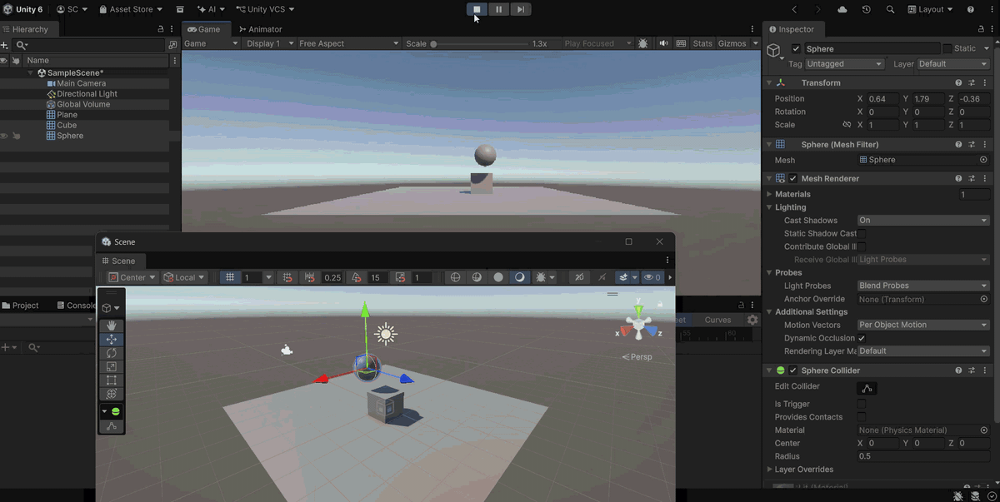

### Experimentación 2

> El plano no es un objeto físico. El cubo es un objeto físico y la esfera también.

Al añadir el `Rigidbody` también a la esfera, la gravedad actúa directamente sobre ella. Al ejecutar la escena, la esfera cae en picado e impacta contra el cubo. Como ambos poseen `Rigidbody` y `Collider`, se produce una colisión sólida entre cuerpos rígidos en la que ninguno se atraviesa y se transfieren fuerzas. Debido a la energía del impacto, la esfera rebota y cae sobre el plano, que frena su caída gracias a su `Collider`. Sin embargo, por la inercia acumulada tras el choque, la esfera empieza a rodar sobre la superficie hasta alcanzar el borde, cayendo finalmente al vacío.

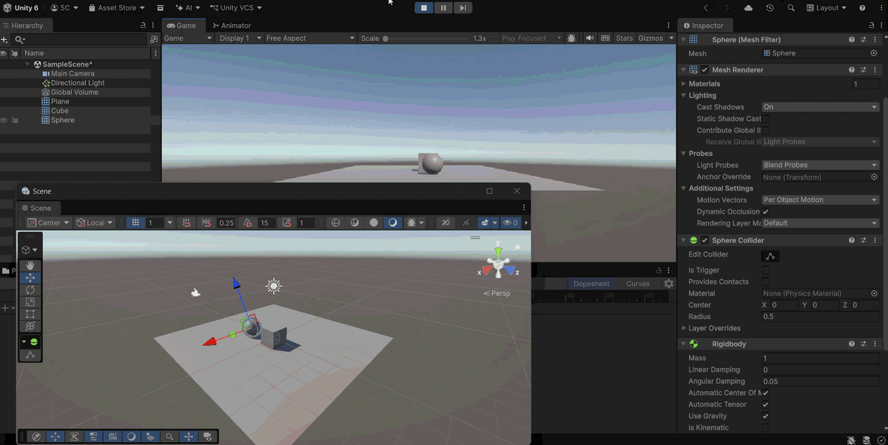

### Experimentación 3

> El plano no es un objeto físico. El cubo es un objeto físico y la esfera es cinemática.

Con el plano como colisionador estático, el cubo como objeto dinámico y la esfera con un `Rigidbody` marcado como **Is Kinematic**, la esfera permanece suspendida en el aire sin caer. La propiedad cinemática indica al motor de físicas que no aplique gravedad ni fuerzas automáticas sobre ella, dejando su posición bajo control directo.

Al desplazar la esfera manualmente contra el cubo, las colisiones responden correctamente, respetando los volúmenes sin solaparse y manteniendo la estabilidad con el plano. A diferencia de la experimentación 1, al tener un `Rigidbody` cinemático Unity reconoce la esfera como un **objeto móvil** y calcula correctamente su velocidad y trayectoria, por lo que transfiere su movimiento al cubo de forma fluida y natural: el cubo sale empujado mientras su propia gravedad lo mantiene apoyado y deslizándose sobre el plano.

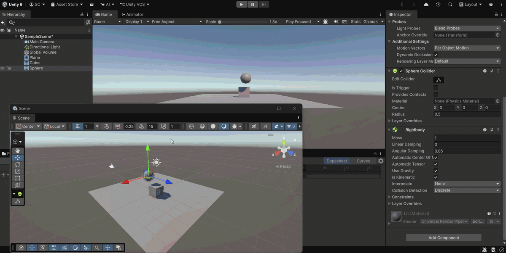

### Experimentación 4

> El plano es un objeto físico. El cubo es un objeto físico y la esfera también.

Con los tres objetos configurados como cuerpos rígidos dinámicos (gravedad activada e *Is Kinematic* desmarcado), todos caen juntos al vacío de forma inmediata. El plano deja de actuar como superficie estática o punto de apoyo: al tener un `Rigidbody` dinámico, PhysX le aplica la misma aceleración gravitatoria que al cubo y a la esfera. Al no existir ningún colisionador estático ni cinemático por debajo que lo sostenga, todos los objetos caen indefinidamente.

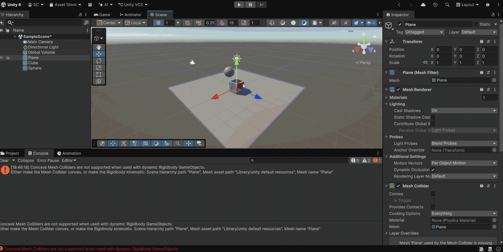

### Experimentación 5

> El plano es cinemático. El cubo es físico y la esfera es física con 10 veces más masa que el cubo.

Al marcar el `Rigidbody` del plano como **Is Kinematic**, este deja de caer y vuelve a sostener al resto de elementos como una superficie fija. La esfera cae a la **misma velocidad vertical** que en los casos anteriores, ya que la gravedad acelera a todos los objetos por igual independientemente de su masa. La diferencia está en su **inercia**: al tener 10 veces más masa, acumula una cantidad de movimiento mucho mayor, por lo que al impactar desplaza al cubo con total facilidad. Como el cubo apenas ofrece resistencia, la esfera sufre una desaceleración mínima y continúa rodando de forma fluida y constante sobre el plano hasta llegar al borde.

### Experimentación 6

> El plano es cinemático. El cubo es físico y la esfera es física con 100 veces más masa que el cubo.

Al aumentar la masa de la esfera hasta 100 veces la del cubo, tras la colisión y el impacto contra el suelo la esfera se desplaza a una velocidad **extremadamente lenta** sobre el plano. Al ser la masa tan alta, la fuerza normal que ejerce contra el suelo se multiplica drásticamente, generando una fuerza de rozamiento con el plano mucho mayor que la frena de golpe. Además, su elevada inercia rotacional exige una fuerza enorme para que empiece a girar, por lo que pierde casi todo su impulso horizontal y avanza de forma muy pesada y lenta.

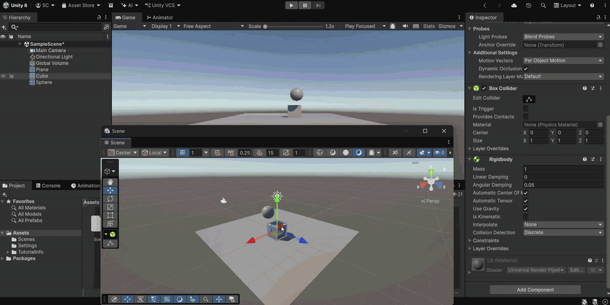

### Experimentación 7

> El plano es un objeto físico. El cubo es físico y la esfera es física con fricción.

Se asigna a la esfera un `Physic Material` con fricción, manteniendo el cubo y el plano con `Rigidbody` dinámico. Al ejecutar la escena, a pesar del rozamiento configurado, todos los elementos vuelven a caer inmediatamente al vacío. El plano vuelve a ser un cuerpo rígido dinámico sin sustentación fija; al no ser cinemático ni un colisionador estático, cae al mismo tiempo que la esfera y el cubo, por lo que no existe una superficie estable sobre la que apreciar el efecto de la fricción.

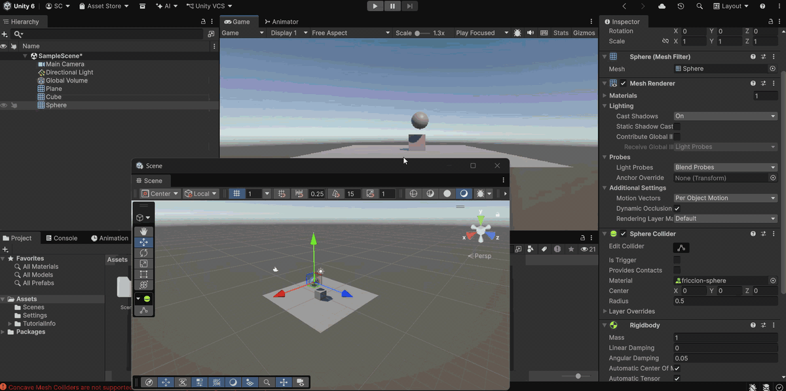

### Experimentación 8

> El plano es cinemático. El cubo es físico y la esfera no es física y es Trigger.

Con el plano cinemático, el cubo dinámico y la esfera sin `Rigidbody` pero con **Is Trigger** activado en su `Sphere Collider`, la esfera permanece suspendida en el aire al no tener `Rigidbody` que le aplique gravedad. Al desplazarla manualmente, atraviesa por completo tanto el cubo como el plano sin generar colisión ni aplicar fuerza alguna. Esto se debe a que *Is Trigger* desactiva la respuesta física sólida del colisionador, de modo que la esfera funciona únicamente como una **zona de detección** traspasable.

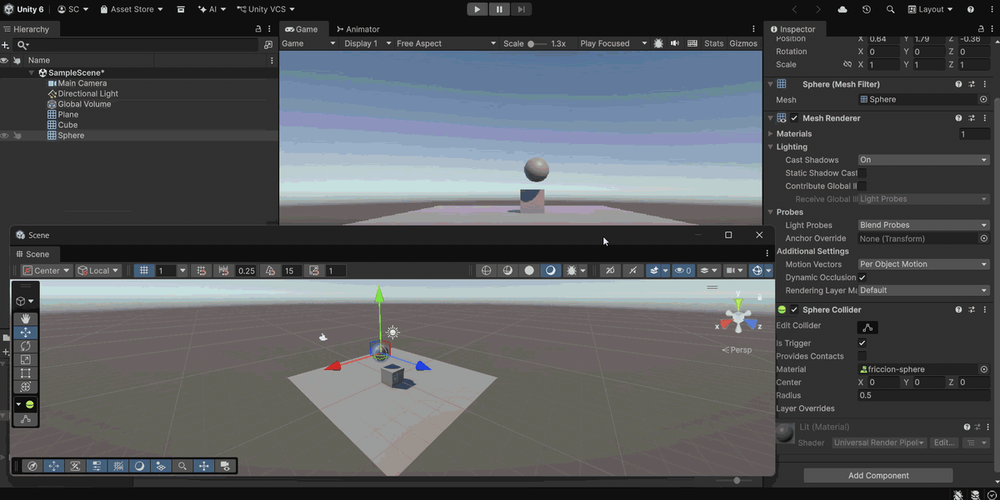

### Experimentación 9

> El plano es cinemático. El cubo es físico y la esfera es física y es Trigger.

En este caso la esfera tiene `Rigidbody` y su `Sphere Collider` marcado como **Is Trigger**. Al ejecutar la escena, la esfera cae en picado por efecto de la gravedad, pero al alcanzar el cubo y el plano los atraviesa por completo sin detenerse ni generar impacto, continuando su caída hacia el vacío. El `Rigidbody` hace que la gravedad la acelere verticalmente, pero *Is Trigger* anula la respuesta de colisión sólida, impidiendo que el motor genere fuerzas de contacto o de apoyo al intersectar con otros volúmenes.

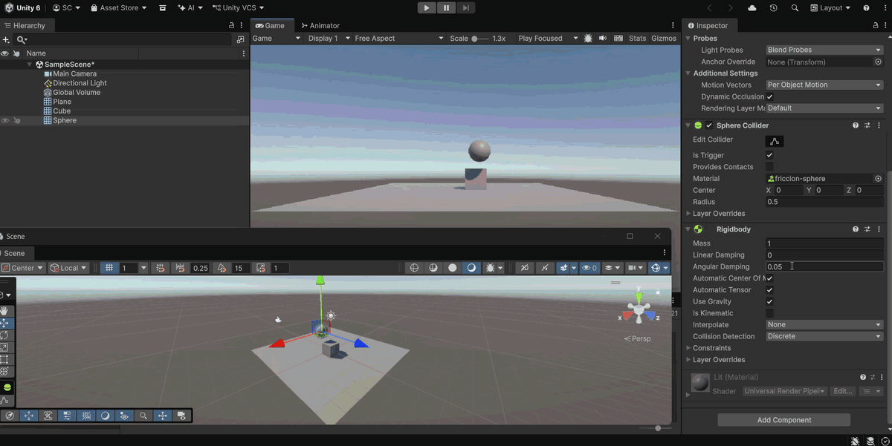

---

## Ejercicios

### Ejercicio 1

> Crea un personaje y controla su desplazamiento con WASD o las flechas usando un Rigidbody, pero manteniendo el control total.

El script separa la **lectura de la entrada** de la **aplicación del movimiento**, siguiendo las buenas prácticas de Unity:

- En `Start()` se obtiene la referencia al `Rigidbody` de la cápsula.
- En `Update()` se leen los ejes `Horizontal` y `Vertical` (que cubren tanto WASD como las flechas) y se construye el vector `movement_direction` en el plano XZ. La entrada se lee aquí porque `Update` se ejecuta cada frame y no se pierden pulsaciones.
- En `FixedUpdate()`, sincronizado con el paso de físicas, se calcula la posición destino sumando la dirección **normalizada** (para que en diagonal no se vaya más rápido) multiplicada por la velocidad y `Time.fixedDeltaTime`, y se aplica con `Rigidbody.MovePosition()`.

El uso de `MovePosition` en lugar de `AddForce` es la clave del "control total": el personaje se mueve exactamente a donde se le indica, sin inercias ni aceleraciones, pero sigue integrado en el motor de físicas y respeta las colisiones. El umbral `magnitude > 0.01f` evita aplicar movimientos cuando no hay entrada.

Script: [Assets/Scripts/01_move_capsule_rigid_body.cs](Assets/Scripts/01_move_capsule_rigid_body.cs)

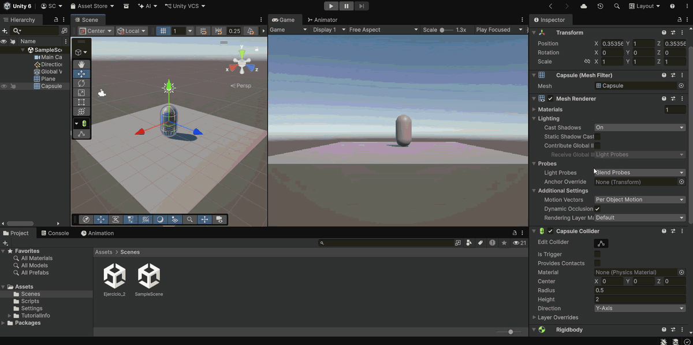

### Ejercicio 2

> Crea varios cubos o esferas con Rigidbody dinámico. Muestra por consola el nombre del objeto con el que colisiona y cámbiale su color al colisionar.

Este script se asigna a cada uno de los objetos con `Rigidbody` dinámico:

- En `Start()` se guarda la referencia al `Renderer` del propio objeto.
- Se implementa el callback `OnCollisionEnter(Collision collision)`, que Unity invoca automáticamente en el primer frame de contacto entre dos colliders no trigger, siempre que al menos uno tenga `Rigidbody`.
- Dentro del callback se muestra por consola el nombre del otro objeto (`collision.gameObject.name`) y se asigna un color aleatorio al material con `Random.ColorHSV()`.

De este modo, cada vez que un objeto choca con otro (o con el suelo) cambia de color y deja constancia en consola de con quién ha colisionado.

Script: [Assets/Scripts/02_collision_changing_color.cs](Assets/Scripts/02_collision_changing_color.cs)

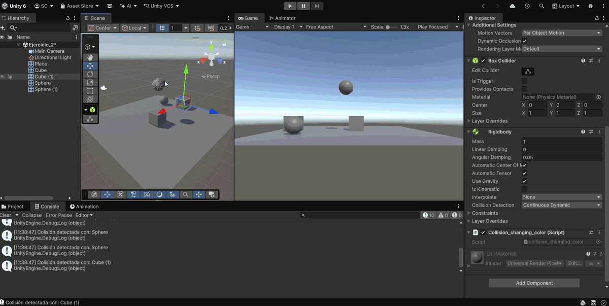

### Ejercicio 3

> Crea una zona trigger que al entrar cambie el color del personaje o active un efecto de luz y al salir lo revierta. Añade otra zona que aumente una variable daño.

El script `PlayerTriggerHandler` se asigna al personaje y combina movimiento y detección de zonas:

- **Movimiento:** igual que en el ejercicio 1, se mueve con `Rigidbody.MovePosition()` dentro de `FixedUpdate()` a partir de los ejes de entrada.
- **Inicialización:** en `Start()` se guarda el `Renderer` y el **color original** del personaje, para poder restaurarlo después.
- **`OnTriggerEnter`:** distingue la zona mediante etiquetas con `CompareTag()`:
  - Si la zona tiene la etiqueta `ZonaColor`, el personaje cambia a `colorEnZona` (rojo por defecto) y se alterna el estado de la luz de la escena (`luzEscena.enabled = !luzEscena.enabled`).
  - Si la zona tiene la etiqueta `ZonaDano`, se incrementa la variable `dano` en 10 y se muestra el valor actual por consola.
- **`OnTriggerExit`:** al salir de `ZonaColor` se restaura el color original y se vuelve a alternar la luz, revirtiendo el efecto.

Las zonas son cubos grandes con `Is Trigger` activado, por lo que el personaje las atraviesa sin chocar, pero se disparan los eventos de entrada y salida. Los campos públicos (`colorEnZona`, `luzEscena`, `speed`) permiten configurar el comportamiento desde el Inspector, y las comprobaciones de `null` evitan errores si no se asigna la luz o el renderer.

Script: [Assets/Scripts/03_player_trigger_handler.cs](Assets/Scripts/03_player_trigger_handler.cs)

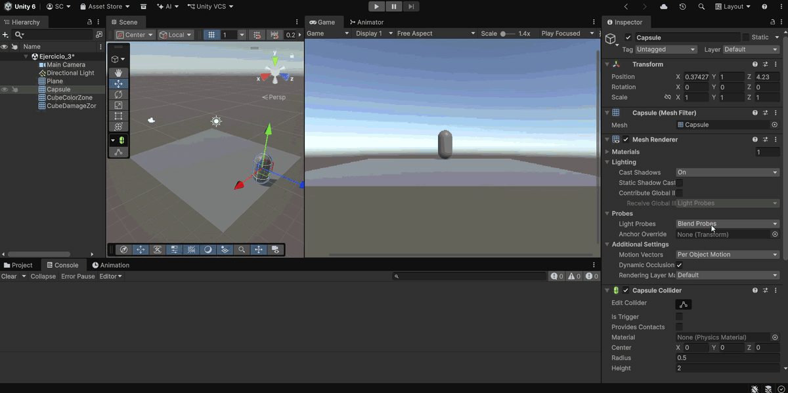

### Ejercicio 4

> Crea tres tipos de objetos en capas distintas: jugador, enemigos y recolectables. Configura la Layer Collision Matrix para que los enemigos solo colisionen con el jugador y que los recolectables solo sean detectados por triggers.

Este ejercicio se apoya principalmente en la configuración del proyecto y en dos scripts sencillos que permiten comprobar su funcionamiento:

- Se crean las capas **Player**, **Enemy** y **Collectible**, y en *Project Settings > Physics > Layer Collision Matrix* se desmarcan las interacciones no deseadas, de forma que la capa `Enemy` solo interactúa con `Player`.
- **`04_enemy_contact.cs`** (en los enemigos): implementa `OnCollisionEnter` y muestra por consola el nombre del objeto con el que el enemigo ha colisionado **físicamente**. Gracias a la matriz de colisiones, este mensaje solo aparece al chocar con el jugador; con el resto de objetos los enemigos se atraviesan sin generar contacto.
- **`04_collectible_trigger.cs`** (en los recolectables): sus colliders tienen `Is Trigger` activado, por lo que nunca generan colisiones sólidas. Implementa `OnTriggerEnter` y muestra por consola qué objeto los ha detectado.

La combinación de la *Layer Collision Matrix* con colliders sólidos o trigger permite filtrar qué objetos interactúan entre sí sin tener que comprobar etiquetas o capas por código.

Script: [Assets/Scripts/04_enemy_contact.cs](Assets/Scripts/04_enemy_contact.cs)

Script: [Assets/Scripts/04_collectible_trigger.cs](Assets/Scripts/04_collectible_trigger.cs)

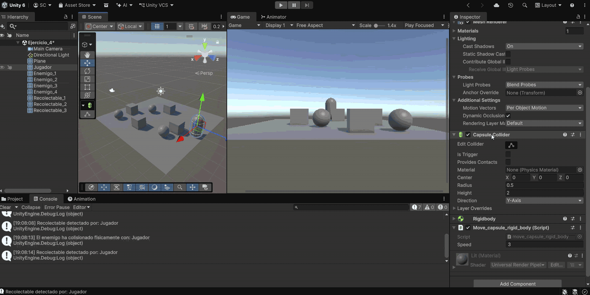

### Ejercicio 5

> Crea una escena con distintos materiales físicos (resbaladizo, rugoso, rebote alto). Lanza los objetos con AddForce() al pulsar la tecla X y observa cómo cambian las reacciones.

A cada objeto se le asigna un `Physic Material` distinto (resbaladizo con fricción baja, rugoso con fricción alta y de rebote alto con `Bounciness` elevado) y este script, que es común a todos:

- Expone en el Inspector la dirección de la fuerza (`direccion_fuerza`, por defecto `(0, 3, 8)`, es decir, hacia delante y algo hacia arriba), su intensidad y el `ForceMode` (por defecto `Impulse`, que aplica un impulso instantáneo).
- En `Update()` se detecta la pulsación de la tecla **X** con `Input.GetKeyDown` y únicamente se activa la bandera `debe_lanzar`.
- En `FixedUpdate()`, si la bandera está activa, se aplica `rb.AddForce(direccion_fuerza.normalized * intensidad_fuerza, modo_fuerza)` y se desactiva la bandera.

Este patrón de bandera garantiza que la entrada no se pierda (se lee cada frame) y que la fuerza se aplique en el paso de físicas, que es donde debe hacerse. Como todos los objetos reciben exactamente el mismo impulso, las diferencias en su comportamiento (cuánto deslizan, cuánto se frenan o cuánto rebotan) se deben únicamente a su material físico.

Script: [Assets/Scripts/05_launch_on_key_x.cs](Assets/Scripts/05_launch_on_key_x.cs)

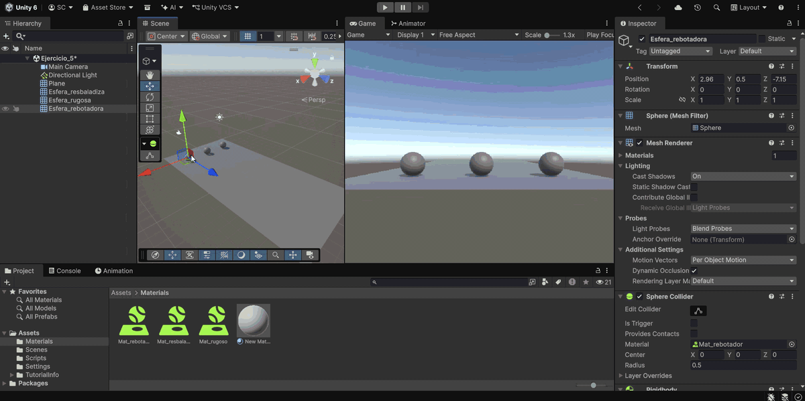

### Ejercicio 6

> Tres objetos con Collider pero sin Rigidbody (cubo, esfera y cilindro alineados). La esfera debe dirigirse al cilindro y, cuando alcance el cubo que hace de obstáculo, este debe cambiar su material.

Como ninguno de los objetos tiene `Rigidbody`, **Unity no dispara los eventos** `OnCollisionEnter` ni `OnTriggerEnter`, por lo que el script detecta el contacto manualmente:

- **Referencias:** desde el Inspector se asignan el cilindro objetivo (`objetivoCilindro`), el cubo obstáculo (`cuboObstaculo`) y el material nuevo. En `Start()` se obtienen el `Collider` de la esfera y el `Collider` y `Renderer` del cubo.
- **Movimiento:** en `Update()` se desplaza la esfera hacia el cilindro con `Vector3.MoveTowards()`, usando `velocidad * Time.deltaTime` para que el movimiento sea independiente de la tasa de frames. Al moverse vía `transform`, la esfera atraviesa el cubo en lugar de detenerse.
- **Detección del contacto:** se combinan dos comprobaciones:
  - `esferaCollider.bounds.Intersects(cuboCollider.bounds)`: comprueba si las cajas envolventes (AABB) de ambos colliders se solapan.
  - Distancia entre centros `<= 1.0f`, como comprobación adicional por coordenadas.
- **Cambio de material:** si se cumple alguna de las dos condiciones, se asigna el nuevo material al `Renderer` del cubo, se muestra un mensaje por consola y se activa la bandera `materialCambiado` para que el cambio solo se realice una vez y no se repita la comprobación en cada frame.

Script: [Assets/Scripts/06_sphere_manual_movement.cs](Assets/Scripts/06_sphere_manual_movement.cs)

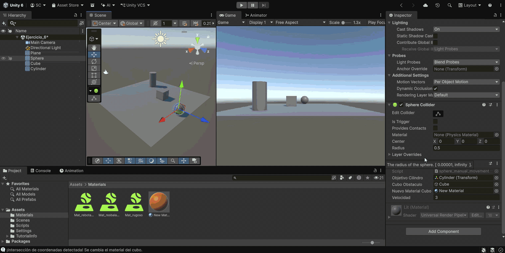
